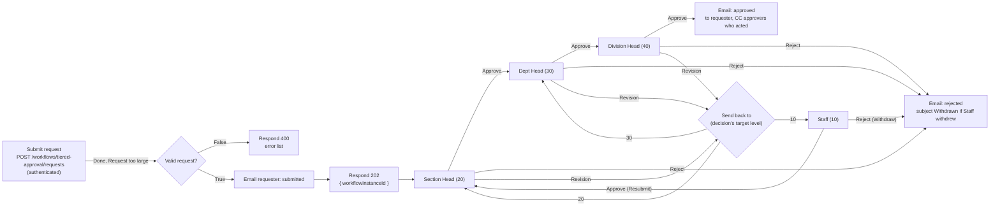

# Elsa.TieredApproval.Web

A minimal Elsa 3 host with one code-first workflow: a four-level approval chain driven entirely by email.
An authenticated client submits a request. Each approver gets an email with one button per allowed action, and the requester gets a final email with the outcome and the full history.

## Levels

The levels and the actions they offer are defined in `ApprovalLevels.cs`. The transitions between them are the connections of the flowchart below.

| Level | Role          | Who acts                         | Actions offered                                     |
|-------|---------------|----------------------------------|-----------------------------------------------------|
| 10    | Staff         | the requester                    | Resubmit (Approve), Withdraw (Reject)               |
| 20    | Section Head  | `approvers["20"]` in the payload | Approve, Reject, Revision to 10                     |
| 30    | Dept Head     | `approvers["30"]`                | Approve, Reject, Revision to 10 or 20               |
| 40    | Division Head | `approvers["40"]`                | Approve (final), Reject, Revision to 10, 20 or 30   |

The rules:

- **Approve** moves the request to the next level. Approve at 40 ends it as *Approved*. At 10 the action is labelled "Resubmit".
- **Reject** ends the request as *Rejected*. At 10 the action is labelled "Withdraw" and the request ends as *Withdrawn*.
- **Revision** sends the request to any strictly lower level. The chain then climbs again, one level at a time, from that level.

## Flow

The workflow (`Workflows/TieredApprovalWorkflow.cs`) is a `Flowchart`, so Elsa Studio draws it (see [Watching it in Elsa Studio](#watching-it-in-elsa-studio)).
Each node has a fixed id, a readable name and a designer position.



`ApprovalStep` (`Activities/ApprovalStep.cs`) is a blocking `Activity<ApprovalDecision>` marked `[FlowNode("Approve", "Reject", "Revision")]`. The four approval nodes are instances of it, one per level.
For each offered action it creates one bookmark and stores `{action, targetLevel, label, levelName, title}` in the bookmark metadata, on the server.
It then emails a signed link per bookmark (7-day lifetime), together with the request history so far.

When a link is used, the named callback reads the action from the resumed bookmark's metadata and the optional `comment` from the resume input. A comment that is not a string is ignored.
It sets `Result` and completes with the action as its outcome. Completing removes the sibling bookmarks, so the other buttons in that email stop working.
Resumes of one request run one at a time, under a per-instance lock (`UseDistributedRuntime`), so two buttons confirmed at the same moment cannot both take effect.

Each step records its own decision. The `History` input is bound to the `History` variable, and the `UpdatedHistory` output is bound to the same variable.
That output receives a new list: the old history plus this decision. Both bindings are plain variable references, so they are serialized with the definition and show in Studio.
The history is persisted with the instance. It feeds the next approver's email, the "Send back to" switch (which reads the last decision's target level) and the final email.

The flowchart loops back to earlier nodes along several paths. Several nodes have more than one inbound connection: Section Head, Dept Head, "Send back to" and "Email: rejected".
The host therefore enables token-based flowchart execution: `UseFlowchart(f => f.UseTokenBasedExecution())`, as `Elsa.Server.Web` does.
The default counter-based mode rejects the "Send back to -> Dept Head" back edge with "Invalid backward connection". With that mode the smoke test fails at request F.
Every node keeps the default merge mode. In token mode that mode schedules a node when a token arrives on one of its connections and no node that feeds it is still waiting to run.
Only one step is ever pending, so each node runs exactly once per arriving token. The smoke test checks this against the instance journal and the per-node execution counts.

## Run

You need the .NET 10 SDK. The modules are built as part of this project.

```powershell
dotnet run --project src/apps/Elsa.TieredApproval.Web    # http://localhost:5180, Development
```

In Development, mail is not sent. Each message is written as an `.eml` file to `src/apps/Elsa.TieredApproval.Web/App_Data/mail`; open one with Outlook or any mail client. The Sqlite database is `App_Data/elsa.sqlite.db`.

Upgrading from the earlier Sequence version, or changing the workflow's structure later: finish or cancel open requests, or delete `App_Data`, before starting the new build. The code-first definition keeps the id `TieredApprovalWorkflow:v1` and every instance is resumed against the current class, so requests still in flight cannot continue. Their links still open the confirm page and the resume returns 200, but nothing runs and no email is sent.

Start a request:

```bash
curl -i -X POST http://localhost:5180/workflows/tiered-approval/requests \
  -H "Authorization: ApiKey 00000000-0000-0000-0000-000000000000" \
  -H "Content-Type: application/json" \
  -d '{
        "title": "New laptop",
        "description": "Current one is 6 years old.",
        "requester": { "name": "Sam Staff", "email": "sam@example.com" },
        "approvers": {
          "20": { "name": "Sue Section",  "email": "sue@example.com" },
          "30": { "name": "Dan Dept",     "email": "dan@example.com" },
          "40": { "name": "Dee Division", "email": "dee@example.com" }
        }
      }'
# HTTP/1.1 202 Accepted   {"workflowInstanceId":"..."}
```

The development API key and the `admin` / `password` user are enabled only when the environment is Development.

The 202 is returned once the request is stored, after the "submitted" email and the Section Head email have been sent. If sending the "submitted" email fails, the caller gets a 500 instead of a 202. The start run is not cancelled if the client disconnects.

Each button in an email opens `GET /approvals/confirm?t=<token>`. That page shows the action, the level and the request title, plus a comment box. Clicking **Confirm** makes the page POST to Elsa's resume endpoint. The URL is built from `Http:BaseUrl`, like the email links. The host refuses any other HTTP method on that route with 405.

```http
POST /elsa/api/bookmarks/resume?t=<token>
Content-Type: application/json

{"input":{"comment":"optional text"}}
```

### Watching it in Elsa Studio

Start this server first, then the Studio host in `src/apps/Elsa.TieredApproval.Studio`:

```powershell
dotnet run --project src/apps/Elsa.TieredApproval.Web       # 1. server, http://localhost:5180
dotnet run --project src/apps/Elsa.TieredApproval.Studio    # 2. Studio, http://localhost:5190
```

Open http://localhost:5190 and sign in as `admin` / `password`.

- **Workflows > Definitions > Tiered approval** shows the diagram above. The definition is code-first, so Studio opens it read-only: it offers no publish (`builder.AsReadonly()`).
- **Workflows > Instances** lists the runs. Open one to see the path it took highlighted on the diagram, and its journal.

For Studio, the server also enables:

- the dashboard API (`UseDashboardApi()`, `UseWorkflowRuntimeDashboard()`), for the home page widgets;
- real-time instance updates (`UseRealTimeWorkflows()`, `app.UseWorkflowsSignalRHubs()`). The hub at `/elsa/hubs/workflow-instance` requires an authenticated caller. Studio sends its access token, and anonymous callers get 401.

### Smoke test

```powershell
pwsh -File src/apps/Elsa.TieredApproval.Web/smoke-test.ps1                      # app on 5180, Studio on 5190
pwsh -File src/apps/Elsa.TieredApproval.Web/smoke-test.ps1 -Port 5280           # if 5180 is busy (Studio on 5290)
pwsh -File src/apps/Elsa.TieredApproval.Web/smoke-test.ps1 -WithStudio:$false   # skip the Studio host
```

The script does the following:

1. Builds the app and the Studio host, then starts the app with a fresh `App_Data`.
2. Checks the API that Studio uses:
   - The definition is an `Elsa.Flowchart` with the 12 nodes, the 20 connections, a label and a distinct position for every node, the History bindings on every approval step, and no publish link.
   - The activity descriptors include `ApprovalStep`.
   - The installed features, the dashboard overview and the `admin` / `password` login all answer.
   - The login token is accepted by the API and by the real-time hub. The hub refuses anonymous callers.
3. Starts the Studio host against the app. Checks that its home page, its sign-in page and its Blazor circuit endpoint answer, then stops it. Signing in itself needs a browser.
4. Checks that an unauthenticated start returns 401. Checks that an invalid, malformed or oversized payload returns the app's 400 error list, and that the instance still finishes.
5. Drives six requests through the real endpoints, using the `.eml` files:
   - Request A: 20 Approve, 30 Revision to 10, 10 Resubmit, 20 Approve, 30 Approve, 40 Revision to 20, 20 Approve, 30 Approve, 40 Approve. Result: Approved.
     After "30 Revision to 10", the script kills the app and starts a new process on the same `App_Data`. The rest of the request must therefore come from Sqlite.
     At the end it checks that the instance journal and the execution report (what Studio highlights) list each node once per visit, in order.
   - Request B: 20 Reject. Result: Rejected.
   - Request D: 20 Approve, 30 Approve, 40 Reject. Result: Rejected, CC 20, 30 and 40.
   - Request E: 20 Revision to 10, 10 Withdraw. Result: Withdrawn.
   - Request F: 20 Approve, 30 Approve, 40 Revision to 30, 30 Approve, 40 Approve. Result: Approved.
   - Request C: 20 Approve and Reject confirmed at the same time. Exactly one of them may take effect.
6. At every step, checks that the revision targets offered are exactly the lower levels.
7. Checks that the confirm page GET does not act on the request, and that a GET of the resume URL embedded in the page is refused.
8. Checks that a used link and its sibling links do not move the workflow, and that a non-string comment does not fault it.
9. Checks that user text is HTML-encoded in the emails and on the confirm page.
10. Stops the app and Studio, whatever the outcome. The script exits non-zero on any failure.

## Switching to a real SMTP server

Remove `Smtp:PickupDirectory`, which `appsettings.Development.json` sets, and configure the server. You can do this in appsettings, with environment variables such as `Smtp__Host`, or with user secrets:

```json
"Smtp": {
  "Host": "smtp.yourcompany.local",
  "Port": 587,
  "EnableSsl": true,
  "UserName": "approvals@yourcompany.com",
  "Password": "<secret>",
  "DefaultSender": "approvals@yourcompany.com",
  "PickupDirectory": ""
}
```

Also set `Http:BaseUrl` to the public URL of the app. Every link in the emails is built from it.

Sending uses `System.Net.Mail.SmtpClient`. It has no OAuth2 support, so Exchange Online with basic SMTP AUTH turned off needs a relay, or a switch to MailKit.

A failed send throws. The activity faults and the workflow gets an incident; the failure is not silently skipped.

## Security notes

- **A link is a capability.** Anyone who has an action link can take that decision. The resume endpoint is anonymous by design, and the token is the only credential. Do not forward approval emails.
- Links expire after **7 days** (`ApprovalStep.LinkLifetime`). Each one works **once**: its bookmark is burned when used, and its sibling links die when the step completes. The confirm page returns 410 for used or expired links.
- The action and target level come from **server-side bookmark metadata**, never from the link, so a link cannot be edited into a different decision.
- Email buttons point at the **confirmation page, not at the resume URL**. Mail security scanners that prefetch GET links therefore cannot approve anything. Only the page's explicit POST acts. The host also returns 405 for a GET of the resume URL, so a scanner that fetches URLs found in the page cannot act either. A scanner that runs the page's JavaScript and submits forms is beyond any design that relies on POST alone.
- Links of the same email used at the same moment are serialized by a per-instance lock, so only the first decision counts.
- The **start endpoint requires authentication** (`Authorize = true`). Recipients come from the payload, so an anonymous start would turn the app into an open mail relay. Any authenticated identity may submit; set `Policy` on the `HttpEndpoint` if only some may. The payload is validated at this boundary:
  - The body is at most 64 KB and must be valid JSON.
  - The title is required and at most 200 characters. Names are at most 200 characters.
  - The requester and all three approvers need valid bare email addresses.
  - Approver keys other than 20, 30 and 40 are rejected.
  - Only a valid request is kept in the `Request` variable. Elsa's activity execution log still records the raw body as the `HttpEndpoint` output, which the 64 KB limit bounds.
- All user-supplied text is HTML-encoded in emails and on the confirm page: title, description, names and comments (`Templates.cs`). Comments are capped at 2,000 characters.
- Outside Development, the development API key and admin user are off. `Identity:Tokens:SigningKey` must be set to a real secret: the `CHANGE_ME...` placeholder is rejected at startup.

## Known limits

- Approvers are taken from the request payload. There is no directory lookup, and no check that the person clicking is the intended approver: holding the link is enough.
- Link tokens are encrypted with ASP.NET Core Data Protection, using the default per-machine key ring. Multi-instance or containerised deployments must persist and share the key ring, or existing links stop working.
- Emails are sent inside the workflow step. Retrying a faulted step can send a duplicate email. There is no reminder or escalation when nobody acts; links simply expire after 7 days and the instance stays suspended.
- The confirm page reports success whenever the resume endpoint returns 200. Elsa also returns 200 for a link that someone else used a moment earlier: the click is not applied, but the page still says "recorded".
- A Revision to Staff carries only a comment. The title and description cannot be edited, so the requester resubmits with the corrections in the comment, or withdraws and submits a new request. The Staff email says so.
- Persistence is Sqlite and locks are files under `App_Data/locks`, so the app runs on one node only. To scale out, use a shared database and a cross-node `IDistributedLockProvider` (Redis, SQL Server, PostgreSQL).
